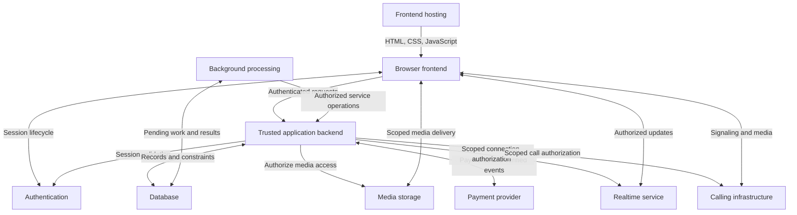
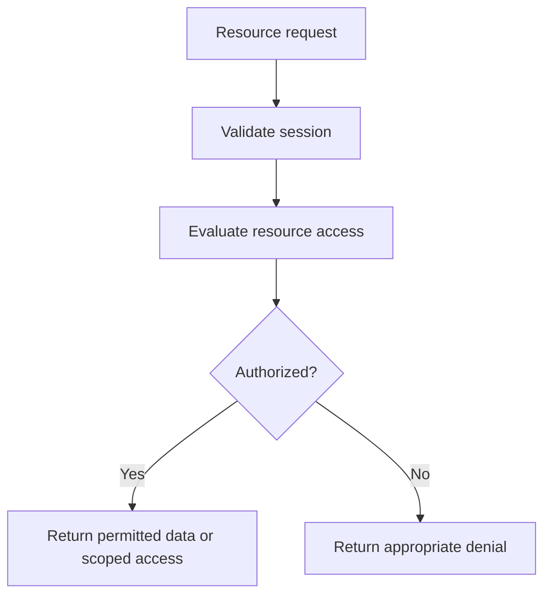
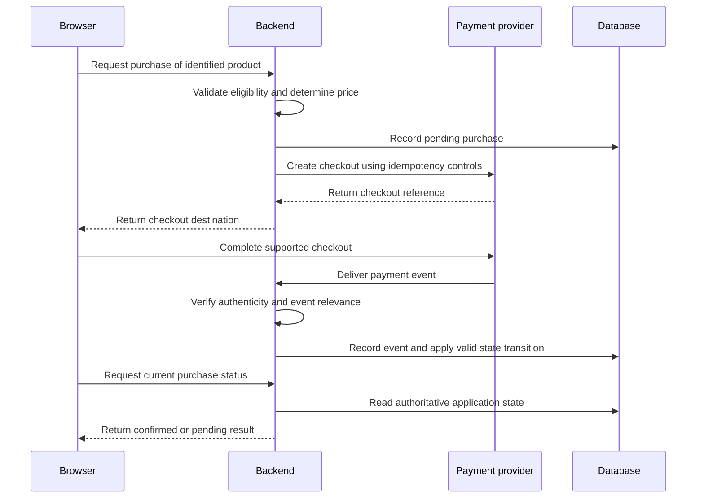
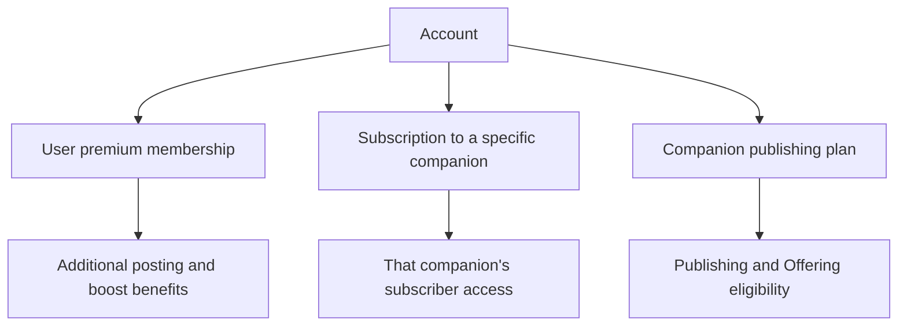
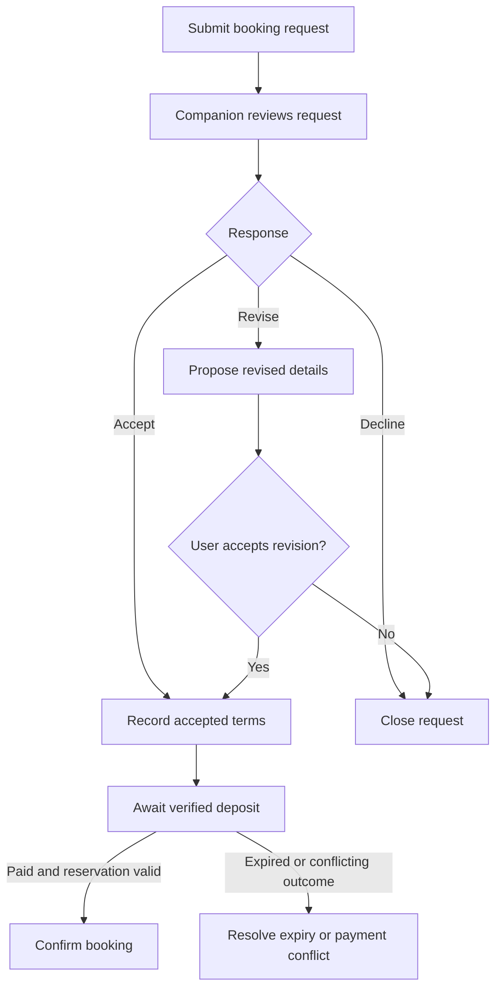
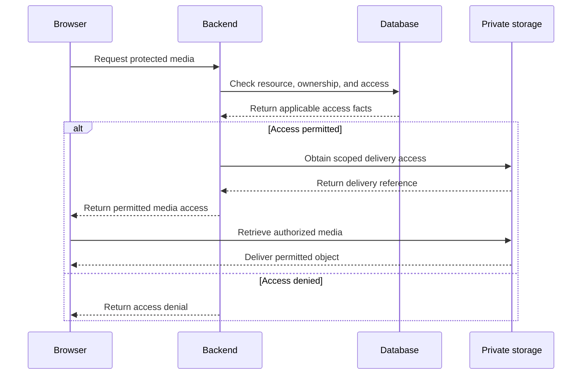
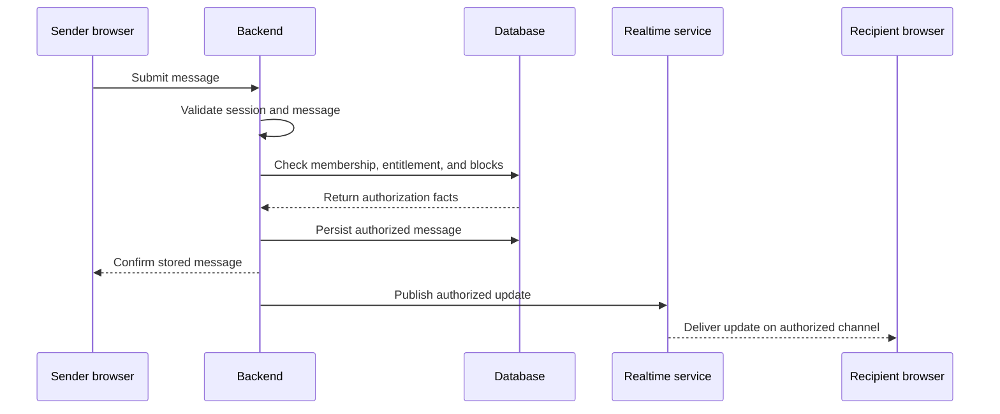
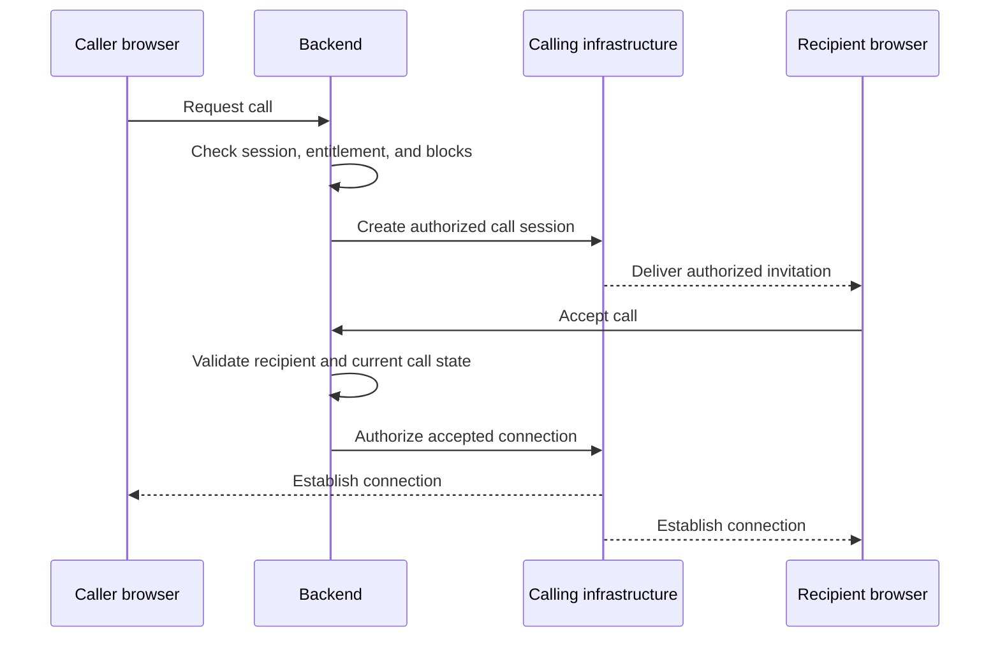
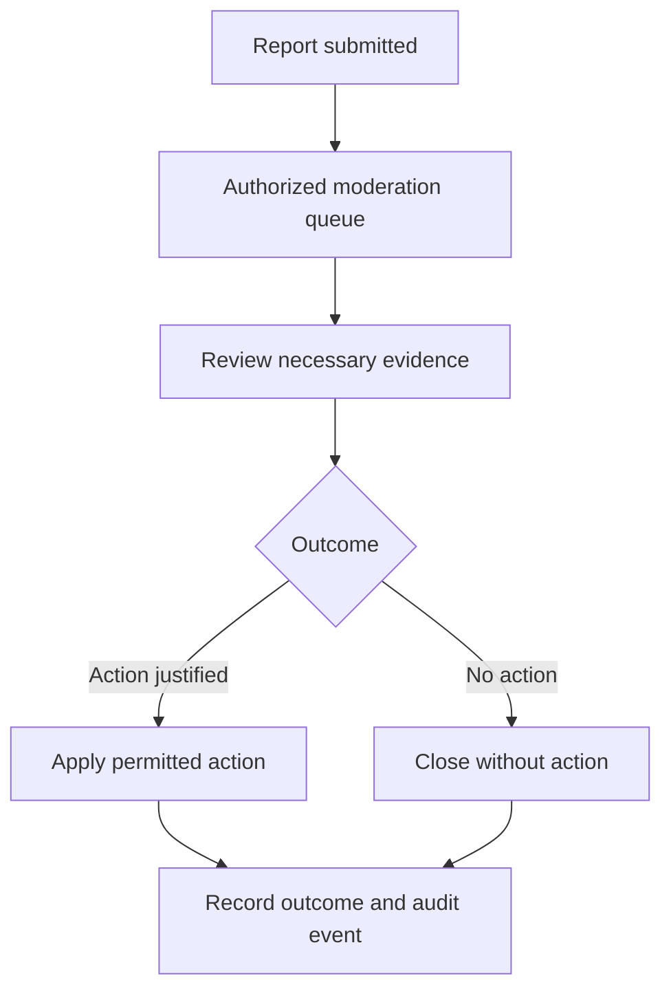
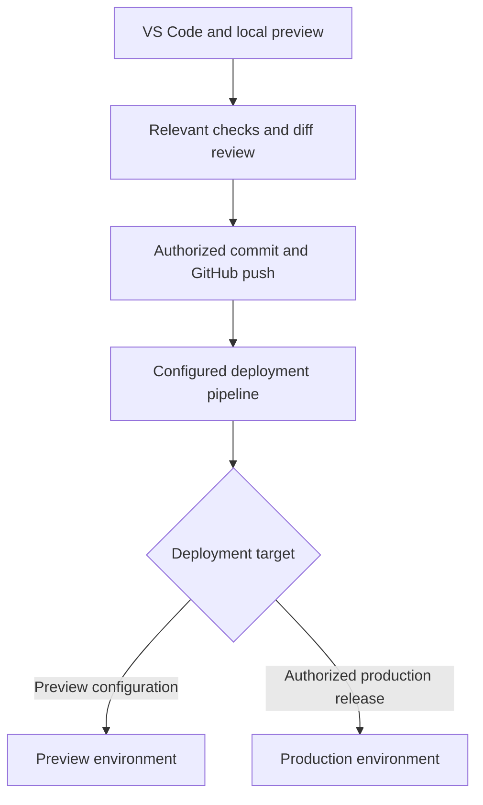

# MeetDiscreet — Application Diagrams

## 1. Purpose

These diagrams describe MeetDiscreet’s intended application structure
and critical interaction flows.

They show logical responsibilities, not selected providers or
verified deployments.

Read alongside:

- [Application Architecture](./application_architecture.md)
- [Environment](./environment.md)
- [Data Model](./data_model.md)
- [Access Matrix](../product/access_matrix.md)
- [Pricing and Payments](../product/pricing_and_payments.md)
- [Booking Lifecycle](../product/booking_lifecycle.md)

Some referenced documents may be created later.

## 2. Diagram Status

Current status: proposed architecture.

Not yet established:

- Backend provider.
- Database and storage services.
- Authentication provider.
- Payment provider.
- Realtime service.
- Calling infrastructure.
- Production hosting.

A diagram does not establish that a feature works.

Update these diagrams when implementation decisions change.
Keep vendor names out until providers are selected.

## 3. Application Topology

These components may be supplied by a small number of services.

The diagram does not require separate deployments for every box.

Provider-specific implementations may support direct browser-to-data
requests when trusted server-side policies enforce equivalent permissions.

Document the chosen implementation before introducing that path.

## 4. Trust Boundaries

| Boundary | Responsibility |
|---|---|
| Browser | Display information, collect input, request actions |
| Authentication | Establish identity and session validity |
| Application backend | Validate input, authorize actions, enforce domain rules |
| Database | Persist records and enforce appropriate constraints and policies |
| Storage | Deliver only media permitted by storage policy or scoped access |
| External services | Perform supported payment, messaging, or calling operations |
| Administration | Perform explicitly authorized operational actions |

Anything received from the browser is untrusted.

Client-supplied roles, prices, ownership claims, and entitlement flags
must not establish authority.

## 5. Protected Resource Access

Public resources may permit anonymous access.

For restricted resources, evaluate applicable:

- Role.
- Ownership.
- Visibility tier.
- Companion-specific subscription.
- Publishing status.
- Account restrictions.
- Block relationships.

Return only permitted fields.

Do not return restricted content and rely on the frontend to hide it.

## 6. Subscription and Purchase Flow

The browser’s return from checkout is not proof of payment.

Event handling must account for:

- Duplicate delivery.
- Out-of-order events.
- Delayed confirmation.
- Failed payments.
- Refunds and disputes.
- Interrupted processing.

Persist enough information to reconcile incomplete operations.

Do not grant entitlements twice when the same event is retried.

## 7. Separate Commercial Entitlements

These purchases serve different purposes.

Premium user membership does not unlock companion communication.

A companion subscription does not grant access to every companion.

Publishing does not grant administrative permissions.

Treatment of access after publishing expiry remains subject to
the confirmed product rules.

## 8. Booking and Deposit Flow

This is a proposed interaction flow.

The detailed lifecycle must define:

- Reservation creation and expiry.
- Availability checks.
- Concurrent acceptance.
- Material revisions.
- Deposit collection.
- Late payment.
- Cancellation.
- Remaining balance.
- Refunds.
- Early endings.

The proposed single 10% deposit remains pending confirmation.

Do not infer a second booking-request charge from this diagram.

## 9. Booking State and Financial State

Keep these records related but distinct.

| Record | Examples of state |
|---|---|
| Booking | Requested, awaiting acceptance, confirmed, completed, cancelled |
| Payment | Pending, succeeded, failed |
| Refund | Requested, processing, completed, failed |
| Payout | Pending, eligible, paid, held |

Exact state names belong in the booking and payment specifications.

A cancelled booking does not prove a refund completed.

A successful payment does not automatically resolve an expired reservation.

A completed booking does not prove a payout was made.

## 10. Restricted Media Delivery

Temporary access may remain usable until expiry, depending on the
selected storage mechanism.

Choose access duration and revocation behaviour deliberately.

Private originals must not appear in:

- Public repository assets.
- Static build output.
- Public metadata.
- Unrestricted API responses.
- CSS-blurred full-resolution images.

Generate safe previews separately where required.

## 11. Messaging Flow

Persisting a message and publishing an update can fail independently.

Use a recoverable delivery mechanism appropriate to the selected service.

The recipient must be able to recover missed messages from stored history.

Apply access controls to:

- Conversation history.
- Attachments.
- Read receipts.
- Realtime channels.
- Notifications.

Historical access after subscription expiry remains a product decision.

## 12. Audio and Video Calling

This diagram abstracts provider-specific signaling and connectivity.

The implementation must handle:

- Permission denial.
- Declined calls.
- Missed calls.
- Expired invitations.
- Disconnects.
- Device changes where supported.
- Session cleanup.

Recheck relevant authorization when actions occur.

No recording is enabled by default.

## 13. Moderation Actions

Reports do not automatically establish misconduct.

Limit evidence access to authorized personnel and necessary information.

Suspension and content removal must have defined effects on
existing subscriptions, bookings, and financial obligations.

Do not invent those consequences in implementation.

## 14. Development and Deployment Flow

This diagram describes the intended workflow.

Do not claim a pipeline exists before configuration and verification.

A push does not prove a deployment succeeded.

Production and preview environments require separate appropriate
configuration and data boundaries.

## 15. Documentation Maintenance

Update this file when changes affect:

- Component responsibilities.
- Trust boundaries.
- Payment confirmation.
- Booking transitions.
- Media delivery.
- Realtime communication.
- Deployment topology.

Keep detailed product rules in their authoritative documents.

Do not introduce unsupported vendor-specific behaviour into these diagrams.

## 16. Final Rule

Use diagrams to explain the application clearly.

Keep planned structure separate from implemented infrastructure.
Keep interface access separate from backend authorization.
Keep booking, payment, refund, and payout states distinguishable.