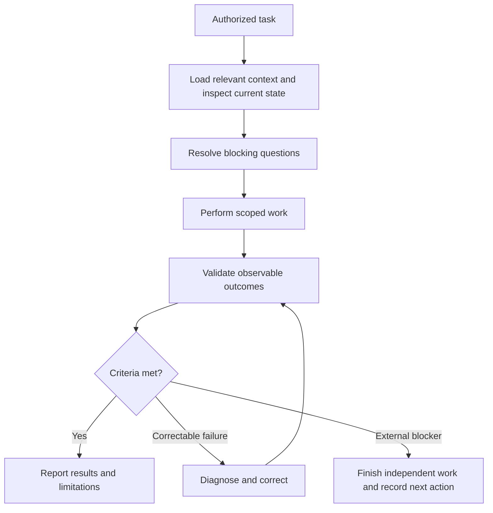

# MeetDiscreet — Engineering Workflow Diagram

This diagram describes responsibilities, not installed orchestration or separate
agents. Follow [root instructions](../../AGENTS.md) and apply the
[workflow guide](../workflow/workflow_engine.md) proportionally.

Supporting guidance:

- [Context loading](../development/context_and_rate_limits.md).
- [Instruction priority](../strategy/instruction_priority.md).
- [State and handoffs](../workflow/state_manager.md).
- [Validation](../workflow/validation_agent.md).
- [Evidence](../strategy/metrics.md).
- [Failure recovery](../security/failure_handler.md).

Passing checks establish only tested outcomes. They do not guarantee
correctness in every condition or automatically establish production readiness.
